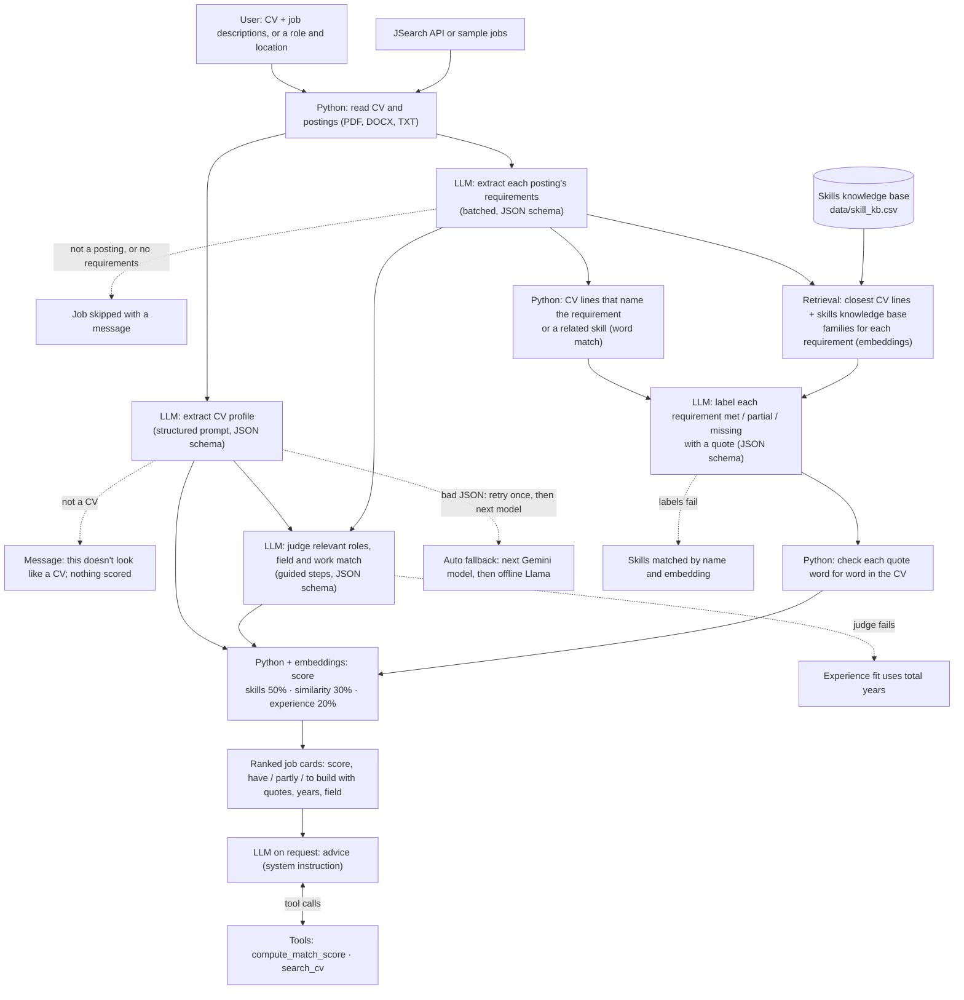

# SEAblings: CV-to-job matching

IS883 Fall 2026, Group 3. Upload a CV, enter a target role (location optional), and get current job
openings ranked by how well your skills match, with matched skills, gaps, and advice per role.

## How it works

1. **Parse CV** (`core/cv_parser.py`): PDF/DOCX/TXT to text, in memory only. PDFs are read in layout
   mode, which keeps each printed line on its own line. Without a CV, the user picks one of 5 fictional
   sample CVs (`core/samples.py`, `data/sample/`).
   **Check the inputs** (`core/validation.py`): simple rules, no LLM call, so a wrong input costs no quota.
   A CV scores points for section headings, date ranges, contact details and a degree; a job description for
   job-posting phrases; each must score enough and read more like its own type than the other. Each input
   shows its result on its own line. The sample CVs and postings skip this check. This is the first of two
   checks: the LLM's check in step 2 and step 4 still runs on what passes.
2. **Extract profile** (`core/skill_extractor.py`): Gemini returns skills, years of experience, level as JSON,
   and says what kind of document it read. If it isn't a CV (a recipe, a letter), the app says so and
   stops (`core/input_checks.py`).
3. **Search jobs** (`core/job_sources/`): JSearch API (aggregates Google for Jobs, incl. Indeed listings),
   or offline sample data. With no location, it searches across the US. A role with fewer than 2
   different letters or over 80 characters is rejected with the input checks in step 1. Without a job description, the 10 fictional sample postings are used.
4. **Extract job requirements**: one batched call for all jobs (one call per job on the offline model).
   A text that isn't a job posting, or has no requirements at all, is skipped with a message and
   never scored.
5. **Judge relevant experience** (`prompts/judge_experience.md`): which CV roles count toward each job,
   and how close the field and kind of work are.
6. **Check each requirement** (retrieval, `core/requirements.py`):
   - For every required skill, the 2 closest families in the skills knowledge base
     (`data/skill_kb.csv`, `core/knowledge.py`) are retrieved by embeddings, and so are CV lines:
     up to 2 that name the skill word for word, 1 that names a related skill from those families,
     then the 3 closest by embeddings. The word match comes first because embeddings alone miss a
     short name like "Python" inside a long skills line.
   - The LLM labels the skill met, partial or missing from that text alone, with a quote
     (`prompts/label_requirements.md`).
   - Code keeps a quote only if it appears word for word in the CV.
   - A second check on "missing": if a retrieved CV line names the skill word for word, code keeps
     that line (`mention`), and the card says it may not be a real gap. No extra LLM call.
   - Under Skill coverage, the card groups the skills: **Partly met** (the LLM's reason and a shortened
     quote), **May not be a real gap** (the CV line that names it) and **Not found in your CV**. Met skills
     show as "You have" chips without quotes (`SHOW_MET_QUOTES` in `core/score_notes.py` turns them back on).
7. **Score** (`core/matcher.py`): `50% skill coverage + 30% profile similarity + 20% experience fit`.
   - A partly met skill counts half toward skill coverage.
   - Embeddings come from `core/embeddings.py`: Gemini, or a local model without a key.
   - The formula is fixed, so the same labels and inputs give the same score.
   - Each card explains its three scores (`core/score_notes.py`): skills you have, have partly or need
     to build, with the CV lines behind them; the field, type of work and level of the CV beside the
     job's; and the roles counted as experience.
8. **Advice** (on demand, tool calling, `core/advisor.py`): the model gets no score in its prompt.
   - It calls `compute_match_score`, which runs the formula above, and `search_cv`, which retrieves
     CV lines for a phrase.
   - It writes advice that may only reword what the CV already says: **Fit**, then **Tailor your CV** for
     partly met skills and for missing skills a CV line names (`cv_mention`), asking to make that line
     show the requirement more clearly. No Gaps list: Skill coverage already shows what's not found.
   - The card shows which tools it used.

## Using the app

The main page opens with a short intro, then two sections side by side: **1. Your CV** and **2. Jobs to
match**. The sidebar holds the **AI model** menu (with a connection check) and the app's **Limitations**. **New search**,
beside the results, clears them and the job inputs but keeps your CV. During a run, numbered steps show
what's finished, and your profile and the jobs appear as soon as they're ready. If a later step fails, that
work stays on the page with **Try again** (finished steps come back from the cache, with no new calls) and
**New search**.

## Choosing a model

The **AI model** menu in the sidebar offers each Gemini model listed in `GEMINI_MODELS`, an offline
Hugging Face model (when installed), and **Auto**. Gemini's free tier limits requests per day
*per model*, so Auto tries the models in order and moves on when one hits its quota or is
overloaded. The offline model is the last resort: no quota, but slower and less accurate.

**Offline model.** Llama 3.2 1B Instruct (4-bit GGUF, about 0.8 GB) runs inside the app with
`llama-cpp-python`, the same setup as the course's `llama_demo`. It downloads from Hugging Face the
first time it's used and again after each app restart. Output is constrained to the expected JSON
schema, which keeps a small model's extraction well-formed. It reads each job separately, so fewer
jobs means faster results.

Embeddings use Gemini (`gemini-embedding-001`) whenever `GEMINI_API_KEY` is set, and a small local
model (bge-small, GGUF, via `llama-cpp-python`) otherwise; set `EMBEDDINGS = "local"` to force the
local one. Gemini's free tier embeds about 100 texts and 30,000 tokens per minute, and one search
embeds the CV, each job, and every unique skill; at the limit the app waits (up to a minute, with a
message) and tries once more. When Gemini's *daily* embedding quota is used up, the app says so and
switches to the local model for the rest of the session, then repeats that search's embedding steps
on it. Picking another chat model wouldn't help, because embeddings have their own quota. For profile similarity the CV and each posting are embedded up to
7,000 characters with Gemini (3,000 with the local model); the LLM reads up to 10,000 characters of
each posting. Similarity thresholds and bands differ per embedding model and per length
(`core/embeddings.py`); see `eval/README.md` (step 6, revisited) for how they were checked.

**Experience fit** (`EXPERIENCE_FIT`, `core/experience.py`) can count *relevant* years instead of
all years: `"roles"` keeps CV roles whose embedding is close to the job; `"judge"` asks the LLM
which roles count (one extra call per search, guided steps, CV only). Either way the years are
added up in Python from the roles' dates. Default `"judge"` (best in `eval/README.md` step 5); if
the judge call fails, that search falls back to all years. `"total"` counts every year on the CV.

**Profile similarity** (`PROFILE_SIMILARITY`, `core/similarity.py`): `"document"` (default)
compares the whole CV with the whole posting; `"summary"` compares the CV summary with a 2-3
sentence `role_summary` written during requirement extraction (no extra call); `"chunks"` averages
each job's 3 closest CV chunks. Each mode has its own cosine band in `core/embeddings.py`; document
ranked best in `eval/README.md` (step 6).

**Requirement labels** (`REQUIREMENT_LABELS`): `"llm"` (default) runs the requirement check in step 6.
It adds one LLM call per search and embeds the CV's lines, at most 80 of them. `"match"` skips it:
each skill is matched or missing by name and embedding, as before. If the check fails during a
search, that search falls back to `"match"`. The scoring evaluation in `eval/README.md` (steps 1-7,
`eval/pipeline.py`) was run before this check existed, so it describes `"match"`.

**Skills knowledge base.** `python scripts/build_skill_kb.py --embed` rebuilds `data/skill_kb.csv` and
saves its Gemini vectors in `data/skill_kb_vectors/`, so the app doesn't spend embedding quota on it.
With another embedding model (or after editing the CSV without re-embedding) the app embeds the
entries once when it starts.

## Run locally

```bash
pip install -r requirements-dev.txt
cp .streamlit/secrets.toml.example .streamlit/secrets.toml   # add your keys
streamlit run streamlit_app.py
pytest
```

Keys: Gemini from Google AI Studio; JSearch from RapidAPI (free BASIC plan is hard-capped monthly).
Set `JOB_SOURCE = "sample"` during development to save quota. Each teammate should use their own keys.

## Deploy (Streamlit Community Cloud)

Main file: `streamlit_app.py`. Paste the contents of your `secrets.toml` into App settings > Secrets.
No model weights are stored or downloaded, which keeps the app within free-tier memory limits.

## Project structure

```
streamlit_app.py        UI wiring only
ui/                     components and CSS
core/                   business logic, no Streamlit imports (testable)
  schemas.py            shared data contracts: change only by team agreement
  llm/                  model providers (Gemini, offline Hugging Face) and Auto fallback
  embeddings.py         Gemini or local embeddings, each with its own thresholds
  requirements.py       retrieval for the met / partial / missing labels, and the quote check
  knowledge.py          skills knowledge base: loading, saved vectors, search
  advisor.py            tools the advice model calls (compute_match_score, search_cv)
  input_checks.py       stops a non-CV or a non-posting before it is scored
  validation.py         rule-based checks on the CV, job descriptions and role, before any LLM call
  samples.py            the fictional sample CVs offered on the main page
  job_sources/          one class per provider, same interface
prompts/                prompt templates (version these like code)
data/sample/            fictional CVs (5) and job postings (10) for dev, tests and the demo
data/skill_aliases.csv  skill name lookup table (built by scripts/build_skill_aliases.py)
data/skill_kb.csv       skills knowledge base, the retrieval corpus (built by scripts/build_skill_kb.py)
data/skill_kb_vectors/  its embeddings, saved per embedding model
data/onet/              O*NET software names the lookup table is built from (source below)
scripts/                one-off build scripts
tests/                  pytest, no API keys needed
eval/                   embedding threshold calibration (see eval/README.md)
notebooks/              experiments only; the app never imports from here
docs/                   architecture diagram, screenshots, report assets
```

**Skill data source.** `data/onet/software_skills.csv` is from the O*NET 31.0 Database by the
U.S. Department of Labor, Employment and Training Administration (USDOL/ETA), used under the
[CC BY 4.0](https://creativecommons.org/licenses/by/4.0/) license; O*NET® is a trademark of USDOL/ETA
([onetcenter.org](https://www.onetcenter.org/database.html)). `data/skill_aliases.csv` is derived from it
and a short hand-made list. `data/skill_kb.csv` holds its software categories, with each category's 15
most common tools, and 30 business-skill families written by the team.

## Team ownership

| Area | Files | Owner |
|---|---|---|
| Job data | `core/job_sources/`, `data/sample/` | TBD |
| LLM and extraction | `core/llm/`, `core/embeddings.py`, `core/skill_extractor.py`, `core/cv_parser.py`, `prompts/` | TBD |
| Scoring and evaluation | `core/matcher.py`, `tests/`, evaluation notebook | TBD |
| UI and deployment | `streamlit_app.py`, `ui/`, `.streamlit/`, README | TBD |

## Workflow

- `main` is always deployable; Streamlit Cloud redeploys on every push to it.
- Work on `feature/<short-name>` branches; open a pull request with at least one reviewer.
- Track tasks in GitHub Issues and the Projects board; link each PR to its issue.

## Privacy

CVs are processed in memory and never written to disk or logs. Never commit real CVs or API keys.
Note that content sent to the Gemini API free tier may be used by Google to improve its products.

## Workshop checkpoint
Team name: SEAblings!
Members: Ardian Dominggo Wiryosukarno, Maylada Kanokchoteworakarn, Sheila Hana Fitriani, Tigor Christian Eka Putra Nainggolan

### 0. LOGISTICS
- **Attending the Oct 23 workshop?** Yes
- **Project board link:** https://github.com/orgs/IS883Fall26Group3/projects/1
- **Streamlit app URL:** https://seablings.streamlit.app/

### 1. THE PROJECT, AS IT STANDS TODAY
- **Who the user is:** an MBA student applying for internships or full-time jobs.
- **The task, in one sentence:** for an uploaded CV and one or more job postings, the app lists each
  posting's requirements as met, partially met or missing, quotes the CV line behind each met or
  partial one, gives each job a match score, ranks the jobs, and suggests what to add.
- **The user's input, and what comes back to the user:**
  - In: a CV (PDF, DOCX or TXT, or pasted text) and either job descriptions they already have
    (uploaded or pasted) or a role (location optional) to search live openings.
  - Out: jobs ranked by a 0-100 match score. Each job shows matched and missing skills, the years of
    relevant experience counted against the minimum asked, how close the CV's field and kind of work
    are to the job's, and, on request, short advice on what to add.
- **Every source the app reads (§3.2):**
  - **Users' CVs:** processed in memory, never stored.
  - **Our test CVs:** submitted voluntarily by MBA classmates and friends through a Google Form that
    collects consent for use in this class project only. Kept out of the repository (`.gitignore`).
  - **Job postings:** public posts from company career pages, LinkedIn, Handshake and the Questrom
    Career Center (`eval/data/jobs/`: text and source URL).
  - **JSearch API (RapidAPI):** live job search, used within its free plan.
  - **Google Gemini API:** language model and `gemini-embedding-001` embeddings.
  - **O\*NET 31.0 software names and categories** (USDOL/ETA, CC BY 4.0): our skill-name lookup
    table and part of our skills knowledge base.
  - **Skills knowledge base** (`data/skill_kb.csv`): 30 business-skill families written by the
    team, plus the O\*NET software categories. It is our retrieval corpus.
  - **Offline fallback models from Hugging Face:** Llama 3.2 1B Instruct and bge-small embeddings.
  - **Fictional sample CVs and job postings** in `data/sample/` (5 MBA CVs and 10 postings, all
    people and companies made up).

### 2. WHAT CHANGED SINCE THE PROPOSAL
- **What we changed, and why:**
  - **Ranking several jobs and live job search are built.** Ranking was our stretch target; live
    search (JSearch) is new, so a user without postings in hand can still find matches.
  - **The match score has three parts instead of a count of met requirements:** 50% skill coverage,
    30% profile similarity, 20% experience fit.
    - **Skill coverage:** the share of required skills labeled met, a partial counting half. The
      labels come from the requirement check described in slot 3. If that check fails, a skill counts
      as met when the CV has the same skill under a standard name ("MS Excel" = "Excel") or a very
      close one by embeddings.
    - **Profile similarity:** compares the whole CV with the whole posting by embeddings, then scales
      that down when the LLM rates the field and kind of work as only related or different.
    - **Experience fit:** the LLM picks the CV roles relevant to the job; Python adds up their years
      from the dates.
    - **Why:** postings and CVs share generic wording ("management", "operations", Excel) across
      unrelated fields, so skills alone ranked wrong-field jobs high, and total years counted
      unrelated work.
  - **Met / partial / missing with quoted evidence**, as proposed, now labels each required skill,
    and the quotes are checked word for word against the CV. The minimum years are labeled by
    code from the relevant years counted.
  - **Image input** (a CV or posting as a picture) moved to a stretch goal.
- **What the proposal feedback asked for, and what we did about it:**
  - **A corpus for retrieval: a skills "knowledge database" mapping commonly used related phrasing,
    to inform suggestions and partial matches.**
    - **Done:** a skills knowledge base (`data/skill_kb.csv`, 164 families of related skills: 30
      business-skill families written by the team, such as "Data analysis and business
      intelligence: Tableau, Power BI, Looker…", and 134 O\*NET software categories). It is built
      by `scripts/build_skill_kb.py` and embedded ahead of time.
    - For each job requirement, the app retrieves the 2 closest families by embeddings, and CV
      lines that name the requirement or a related skill, plus the 3 closest CV lines by embeddings
      (`core/requirements.py`, `core/knowledge.py`). It puts them in the
      prompt that labels the requirement met / partial / missing (`prompts/label_requirements.md`),
      so a related skill such as Tableau for Power BI becomes "partial".
    - A separate lookup table (`data/skill_aliases.csv`, about 1,500 names) still maps different
      names for the *same* skill ("MS Excel" = "Excel") for the skill matcher.
  - **Give the model a tool to compute the match score, rather than a number the model makes up.**
    - **Done:** the advice model gets no score in its prompt. It calls `compute_match_score`, which
      runs the app's own formula (`core/advisor.py`, `core/matcher.py: combine_score`) and returns
      the score, its three parts and every requirement's label with its CV quote.
    - It can also call `search_cv`, which retrieves the CV lines closest to a phrase.
    - Gemini decides which tools to call; our loop runs them and sends the results back
      (`core/llm/gemini.py: run_with_tools`, the ReAct loop from Session 5). Each job card shows
      which tools the advice used.
  - **The "what to add" suggestions must never tell a student to claim experience they don't have;
    what is missing and can't be rephrased should be flagged as a gap.**
    - **Done:** the advice system instruction (`prompts/advice_system.md`) says:
      - a suggestion may only make clearer what a quoted CV line already says, with no new tool,
        industry or number;
      - a partial match is phrased as a condition ("If your downstream work was in oil and gas,
        name it");
      - a requirement goes under **Gaps** only after `search_cv` finds nothing for it. (Later replaced:
        the card's Skill coverage lists the skills not found, so the advice no longer repeats them.)
  - **Commits and contribution** (our question; §8.2 item 8, §6.4).
    - **Done:** all four members commit from their own GitHub accounts.
    - **Not yet:** a comment at the top of each section naming who wrote it.

### 3. WHERE THE BUILD STANDS
- **What a user can do on the deployed app today:**
  - Upload or paste a CV, or pick one of 5 fictional MBA sample CVs (finance, marketing and
    consulting, operations, product analytics, corporate planning).
  - Match it against uploaded or pasted job descriptions, the 10 fictional sample postings, or a
    live job search by role and location.
  - A document that isn't a CV, or a text that isn't a job posting, gets a clear message instead of
    a score.
  - See the jobs ranked with a score and its breakdown, and each required skill labeled you have /
    partly / to build, with the CV line that shows it.
  - Ask for advice on any job.
  - If one Gemini model is out of quota or overloaded, the app moves on to the next one, and to an
    offline model as a last resort.
- **For each §5.1 capability we plan to use: where it fires, and its status:**

  | Capability | Where it fires | Status |
  |---|---|---|
  | Structured prompting | Templates in `prompts/`, versioned in git. Each sets a recruiter or coach role and rules. The experience judge (`judge_experience.md`) and the requirement labels (`label_requirements.md`) work through numbered steps and write a reason before the answer; the labels prompt has two worked examples. The advice step sets its role and rules in Gemini's system instruction (`advice_system.md`). | Working |
  | Structured output | Every extraction, the judge and the requirement labels return JSON checked against Pydantic schemas (`core/schemas.py`). A reply that doesn't parse is retried once, then the next model is tried. If the judge fails, experience fit uses total years; if the labels fail, skills are matched by name and embedding. | Working |
  | Retrieval over our own sources | For each requirement, the 2 closest families in our skills knowledge base (`data/skill_kb.csv`) are retrieved by embedding similarity; so are CV lines: those that name the requirement or a related skill, then the 3 closest by embeddings. They go in the labeling prompt, which returns met / partial / missing with a quote (`core/requirements.py`). Code then checks each quote word for word against the CV and drops it if it isn't there. | Working |
  | Tool calling | Advice: Gemini calls `compute_match_score` (the app's formula) and `search_cv` (CV lines closest to a phrase); our loop runs them and returns the results (`core/advisor.py`, `core/llm/gemini.py`). The offline model can't call tools, so the app calls the score tool for it. | Working |

- **A first sketch of our architecture diagram (§5.2):**



- **Cost of one search** (Gemini Flash Lite, measured with `eval/measure_cost.py`):

  | | LLM calls | Tokens in / out | Texts embedded | Time |
  |---|---|---|---|---|
  | 1 CV vs 1 posting | 4 | 3,441 / 1,117 | 25 | 13 s |
  | 1 CV vs 10 postings | 4 | 13,374 / 5,566 | 70 | 29-33 s |
  | Advice for one job (tool calling) | 2 | 1,804 / 129 | 0 | 5 s |

  - The number of LLM calls stays at 4 however many jobs there are, because every step batches all
    jobs into one call.
  - The requirement check is three quarters of the input tokens, since it carries the retrieved CV
    lines for every requirement.
  - The tightest free-tier limit is embeddings: 1,000 texts a day per Google project, so about 14
    ten-job searches. Texts already embedded in a session are reused, and the skills knowledge base
    is embedded ahead of time.

### 4. SUCCESS METRIC (§5.5)
- **The one number that says whether our app is doing its job:** **requirement classification
  accuracy**, the number of correctly classified requirements divided by the total number of
  labeled requirements.
  - A requirement is each required skill and the minimum years of experience the app extracts from
    a posting.
  - It counts as correctly classified when the app's label (met / partial / missing) matches the
    label in our human-annotated answer key.
  - **Target: ≥ 75%** across all requirements in 20 test inputs.
  - **Baseline:** keyword matching, where a requirement is met only if its words appear in the CV.
  - We also report accuracy for each label separately, so a test set that is mostly "missing"
    can't hide errors.
  - **What we count as a good match:** a job where the CV meets most required skills and the minimum
    years, with a CV quote behind each one.
- **Where our test inputs will come from:**
  - 20 CV-job pairs built from the consented MBA CVs and public postings described in slot 1.
  - They include jobs that fit each CV well, plus awkward cases: an empty CV, a document that isn't
    a CV, a posting outside the app's scope, and a pair that shares many skills but is in a
    different field.
  - Each pair's requirements are fixed first; then a teammate labels each one met / partial /
    missing from the CV **before** the app is run on that pair.
  - **Built:** 16 CV-job pairs (9 CVs, 12 postings, 110 requirements: 38 met, 31 partial, 41
    missing), 2 of them confusing pairs, plus the 4 awkward inputs: 20 test inputs. Details in
    `eval/README.md` ("Success metric").
- **Results** (`eval/requirement_accuracy.py`; the app's labels vary between runs, so it ran 3 times):

  | | Accuracy | Met right | Partial right | Missing right |
  |---|---|---|---|---|
  | Keyword baseline | 50.9% | 39% | 0% | 100% |
  | **App, mean of 3 runs** | **70.0%** (66.4-76.4%) | 88% | 31% | 83% |

  - The app beats the baseline by 19 points but is below our 75% target. One run of three reached it.
  - **Partial is the weak spot:** the app gets 31% of the team's partial labels right. People find
    it hard too: two teammates labeling the same 25 requirements agreed on 88% (Cohen's kappa 0.82),
    and all 3 disagreements were met vs partial.
  - **Confusing pairs:** 90% right on average, so a wrong-field job that shares skills doesn't fool
    the labels.
  - **Quotes:** 170 of 171 quotes the app gave were found word for word in the CV; the check
    dropped the one that wasn't.
  - **How we got here:** the first version scored 63.3% on the test set. Its errors showed that
    retrieval missed short skill names (Python, SQL, ETL) inside long CV lines, so we added the word
    match described in slot 3. We then tuned the labeling prompt only on a separate practice set (8
    pairs on CVs and postings outside the test set) to follow our labeling guide, and ran the test
    set once more.
  - **Awkward inputs:** all 4 pass. A recipe uploaded as a CV and a news item pasted as a job were
    first scored like real inputs, so we added the checks in `core/input_checks.py`; now each gets a
    clear message and no score.

### 5. PROOF OF CONCEPT — TWO TEST INPUTS
Both use the fictional sample CV (`data/sample/sample_cv.txt`: corporate planning analyst at an
energy company, 2021-2025, MBA in progress) and the sample jobs in `data/sample/jobs.json`.

**Input A — an ordinary input:** the CV vs job `s6`, Corporate Planning Associate (Meridian Fuels).

| Requirement | Expected (written before running) | App returned |
|---|---|---|
| financial modeling | met: "Built financial models and scenario analyses…" | met |
| budgeting | met (skills line) | met |
| Excel | met: "…KPI dashboards in Power BI and Excel…" | met |
| scenario analysis | met (same line as financial modeling) | **missing** |
| oil and gas industry | partial: energy company, downstream portfolio | **missing** |
| 3+ years | met: about 4 years | met (4 years counted) |

- **Expected overall:** a strong match, ranked first of the 6 sample jobs.
- **App returned:** score 80.0, ranked **second**, behind Data Analyst (82.5). 4 of 6 requirements
  agree with our expected labels.
- **Why:** "scenario analyses" appears only inside a bullet, so it never reached the CV's skill list.
  The app has no "partial", so oil and gas became missing.

**Input B — an input we expect it to get wrong:** the same CV vs job `s4`, Product Analyst, Energy
Transition (Brightcurrent Energy).

| Requirement | Expected (written before running) | App returned |
|---|---|---|
| SQL | met: "Wrote SQL queries to consolidate sales and supply data" | met |
| Python | partial: the CV says "Python (basic)" | **met** |
| product analytics | missing | missing |
| experimentation | missing | missing |
| energy industry knowledge | met: 4 years at an energy company | **missing** |
| 2+ years | met | met (4 years counted) |

- **Expected errors:** Python marked fully met (the app has no partial), and "product analytics"
  possibly matched to the CV's analytics and dashboard skills because the wording is shared.
- **App returned:** score 70.0, 4 of 6 requirements agree.
  - Python was marked met, as expected.
  - "Product analytics" was correctly missing.
  - Not expected: "energy industry knowledge" was marked missing, because the CV's skill list
    holds tools and methods, not industries.
- The same run shows the shared-skills problem: the Data Analyst job at a logistics company ranked
  first. It shares SQL, Python and Excel with the CV, but it is a different field from the CV's
  energy-sector planning work.

**The same two inputs after adding retrieval and per-requirement labels** (same expected labels,
Gemini Flash Lite):

| | First run | Repeated runs |
|---|---|---|
| Input A (`s6`) | 6 of 6 agree; score 95.0, ranked **first** | 5 of 6 in 6 of 7 more runs: oil and gas labeled met instead of partial. 4 of 6 in one run, which also labeled scenario analysis missing. |
| Input B (`s4`) | 6 of 6 agree: Python partial, energy industry met | 6 of 6 in all 4 more runs |

The labels can differ between runs even at temperature 0, so the evaluation will report results
over repeated runs.

### 6. THE PLAN TO OUR PRESENTATION
- **What is left to build, and who owns each piece:**

  | Work | Status | Owner |
  |---|---|---|
  | Labeling guide for met / partial / missing, with examples | Done (`eval/labeling_guide.md`) | _(team to assign)_ |
  | Choose the 20 test inputs, fix their requirement lists, label them before running | Done | Each member |
  | Check each posting's requirement list for missed or invented requirements | Not yet (`*_extraction.csv`) | Each member |
  | Fictional MBA sample CVs and job descriptions, chosen from a menu | Done | _(team to assign)_ |
  | Checks that stop a non-CV or a non-posting | Done | _(team to assign)_ |
  | Evaluation script: app vs keyword baseline, accuracy per label, quotes found | Done (slot 4) | _(team to assign)_ |
  | Cost per search | Measured (slot 3); cost model not yet | _(team to assign)_ |
  | Simpler interface: model settings under "Advanced", shorter job cards | Not yet | _(team to assign)_ |
  | Approximate result without the LLM when the API fails or times out | Partly: fallbacks for the judge, the labels and daily embedding quota | _(team to assign)_ |
  | Confusing examples and a failure our metric can't catch, for the presentation | Not yet | _(team to assign)_ |
  | A comment at the top of each section naming who wrote it | Not yet | Each member |

  Already built: per-requirement labels (met / partial / missing) from retrieved CV lines and the
  skills knowledge base, the word-for-word quote check, and tool-calling advice.

- **What we will cut first if we fall behind:**
  1. Breaking CVs and postings into facets (education, experience, field) and comparing each with
     its counterpart: an experiment we would like to try, not part of the plan above.
  2. The approximate result when the API fails (shown as a plan instead).
  3. Image input (already a stretch goal).

### 7. WHAT WE NEED FROM YOU
- We count each required skill and the minimum years the app extracts from a posting as one
  requirement, and we report requirements the extraction missed separately. Is that an acceptable
  definition, or should every sentence of the posting be its own requirement?

## [Oct 23, 2026] Comments from Professor
- Basic Flow: Input CV+JD --> Calculate score --> Give text advise [reasonable]
- Current Problems: score is inaccurate (do not have industry context)
- To do:
  1) Need to be more clear/be careful of using embedding
  2) Explore co-sine similarity
  3) Comparison about reasoning method e.g., one-shot, chain of thoughts
  4) Add error handling and unhappy cases (need to show some explanation for users what to do next)
  5) Need to define specific how to calculate and steps for success metric
